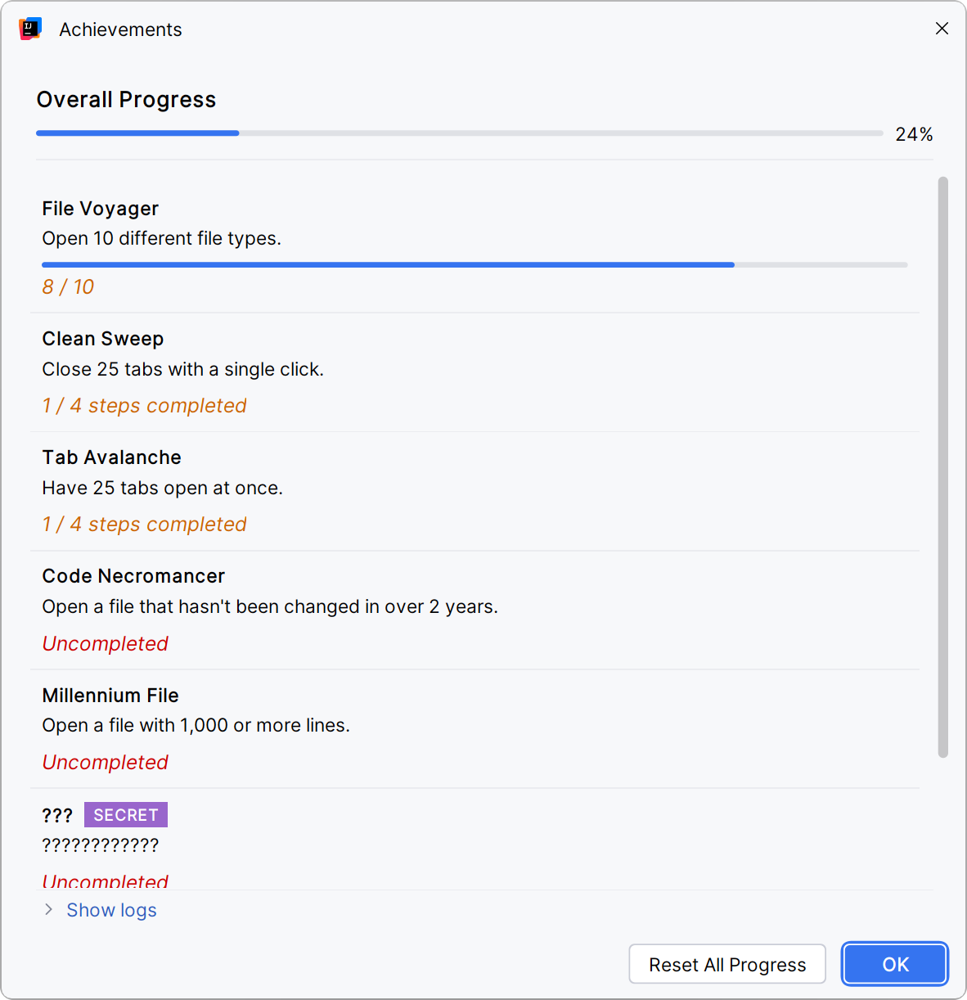

# 🏆 Achievements for IntelliJ


[](https://codecov.io/gh/Andret2344/achievements-for-intellij)
[](https://plugins.jetbrains.com/plugin/29357-achievements)
[](https://plugins.jetbrains.com/plugin/29357-achievements)

<p align="center">
  <picture>
    <source media="(prefers-color-scheme: dark)" srcset=".github/readme/dialog-dark.png">
    
  </picture>
</p>

<!-- Plugin description -->
Turn everyday coding habits into achievements.

Hoard tabs, dig up files nobody has touched in years, wipe out half your editor with a single click and collect file
types like souvenirs. Just code as usual, and the IDE keeps score. Open **Tools | Achievements** to see how you are
doing.

**Achievements**

| Achievement          | How to unlock                                         | Tiers              |
|----------------------|-------------------------------------------------------|--------------------|
| **Code Necromancer** | Open a file that hasn't been changed in over 2 years. | -                  |
| **Millennium File**  | Open a file with 1,000 or more lines.                 | -                  |
| **Tab Avalanche**    | Have a pile of tabs open at once.                     | 10, 25, 50, 100    |
| **Clean Sweep**      | Close a pile of tabs with a single click.             | 10, 25, 50, 100    |
| **File Voyager**     | Open files of many different types.                   | 5, 10, 20, 50, 100 |
| **???**              | ????????????                                          | SECRET             |
| **???**              | ????????????                                          | SECRET             |

Secret achievements stay masked until you find them. No hints here.

**Features**

- A notification the moment you unlock something.
- Progress bars for every tier, plus overall progress across all achievements.
- A log of every unlocked step with its date.
- The achievements window updates live while you work.
- Progress is shared across all your projects.

<!-- Plugin description end -->

## 📦 Installation

Works in IntelliJ IDEA, PyCharm, WebStorm, GoLand, Rider and other IntelliJ-based IDEs, version 2024.2 or newer.

- **From the IDE:** <kbd>Settings/Preferences</kbd> > <kbd>Plugins</kbd> > <kbd>Marketplace</kbd> > search for
  <kbd>Achievements</kbd> > <kbd>Install</kbd>
- **From JetBrains Marketplace:** open the [plugin page](https://plugins.jetbrains.com/plugin/29357-achievements) and
  click <kbd>Install to ...</kbd> while your IDE is running.
- **Manually:** download a [release](https://plugins.jetbrains.com/plugin/29357-achievements/versions) and install it
  with <kbd>Settings/Preferences</kbd> > <kbd>Plugins</kbd> > <kbd>⚙️</kbd> > <kbd>Install plugin from disk...</kbd>

## 💡 Ideas and bugs

Got an idea for a new achievement or found something broken?
[Open an issue](https://github.com/Andret2344/achievements-for-intellij/issues).

## 🛠️ Building from source

```shell
./gradlew runIde        # start a sandbox IDE with the plugin installed
./gradlew test          # run the tests
./gradlew buildPlugin   # build the plugin ZIP into build/distributions
```

---
Based on the [IntelliJ Platform Plugin Template](https://github.com/JetBrains/intellij-platform-plugin-template).
